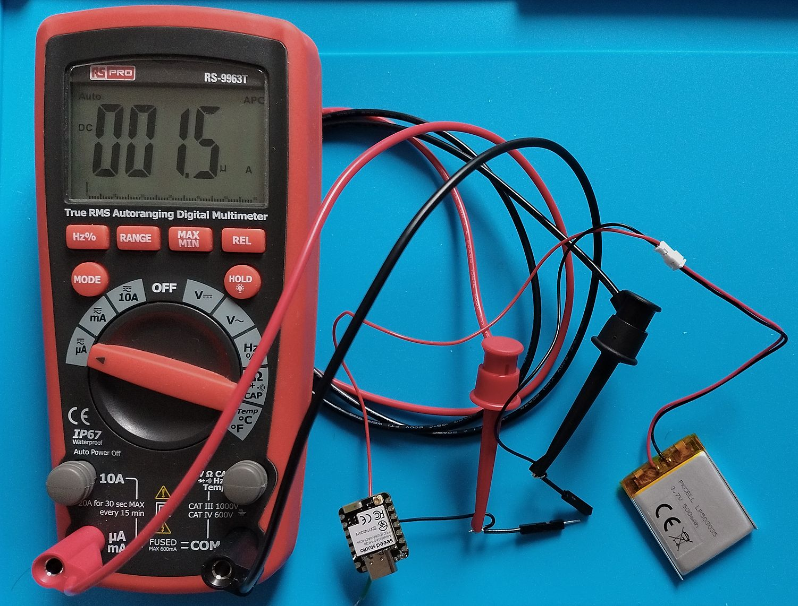
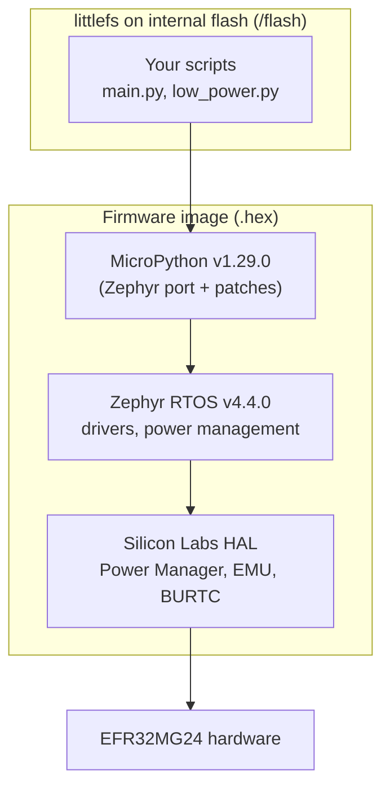
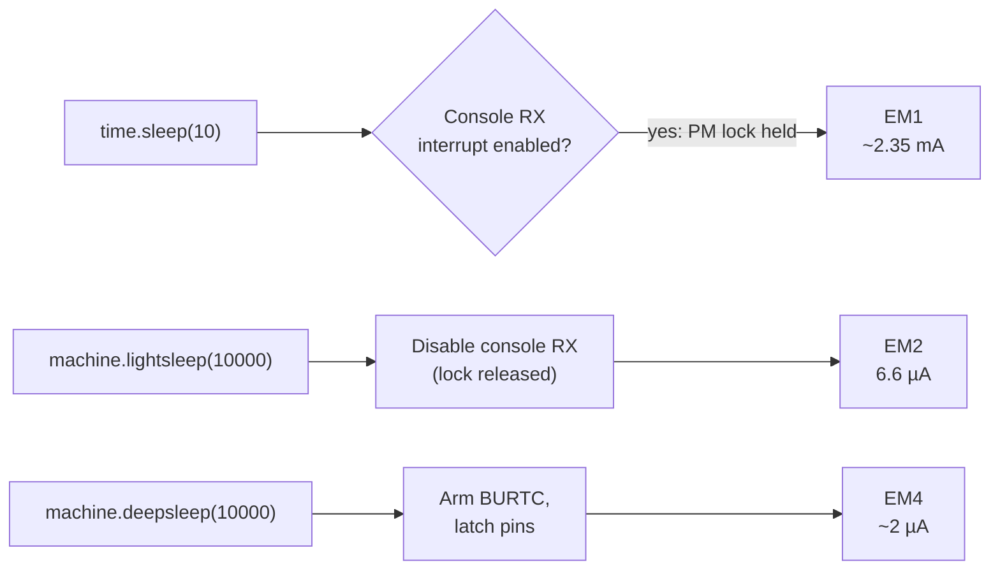
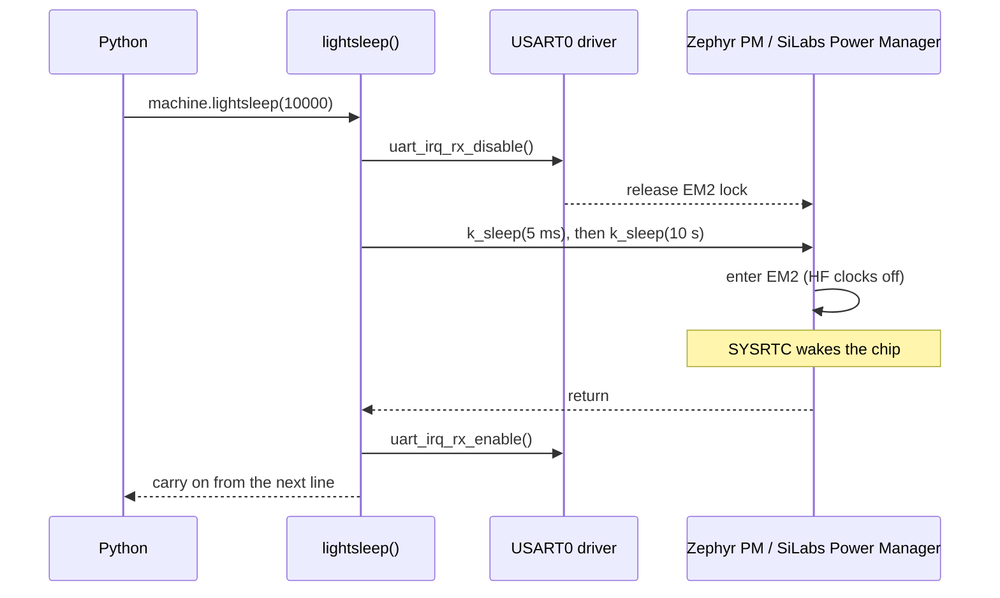
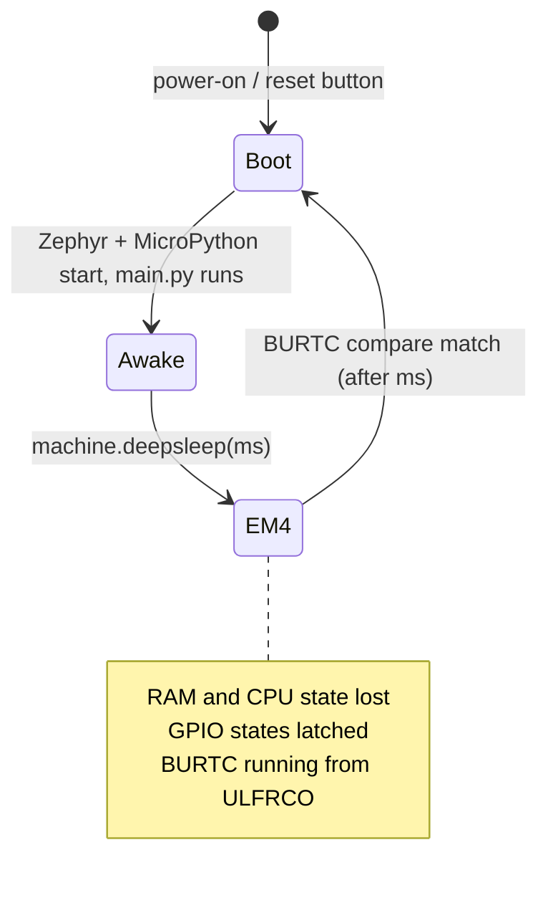
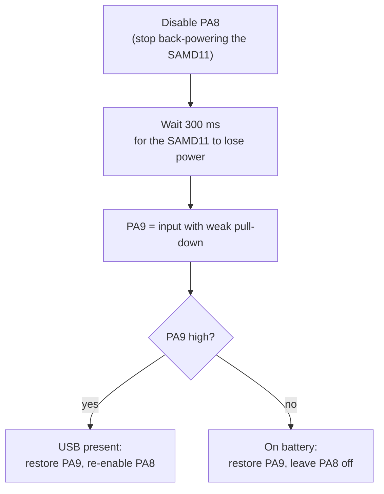
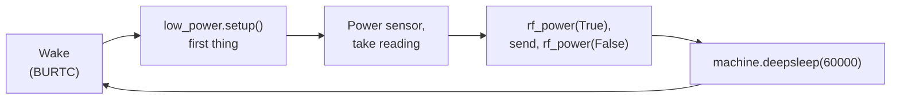
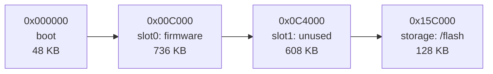
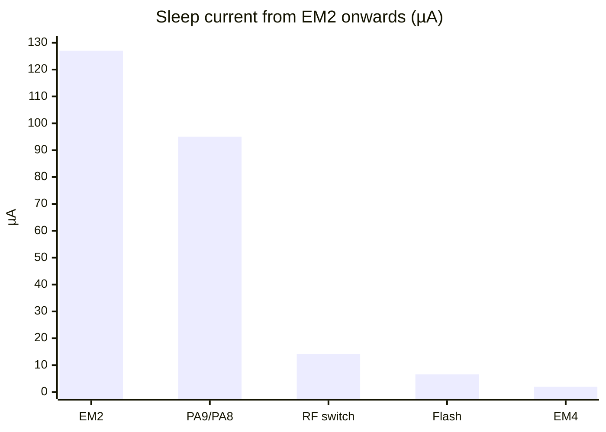
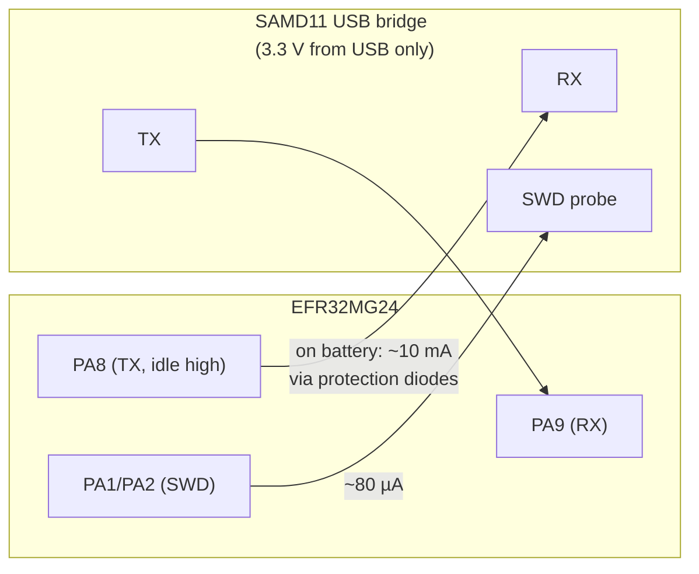

# MicroPython for the Seeed XIAO MG24, with working low-power sleep

Custom MicroPython firmware for the **Seeed Studio XIAO MG24** (EFR32MG24B220F1536IM48) that adds working `machine.lightsleep()` and `machine.deepsleep()`, plus a small Python module that removes the board's known current leaks.

**Author:** Chris Hughes ([@Chrispyodl](https://github.com/Chrispyodl))

<p align="center">
  
  <br>
  <em>The XIAO MG24 in <code>machine.deepsleep()</code>, running from a 500 mAh LiPo. The whole board's current wanders between about 1.1 and 2.5 µA; this snapshot caught 1.5 µA.</em>
</p>

| Mode | Function | Measured board current |
|---|---|---|
| Idle, stock firmware | `time.sleep()` | 13.1 mA |
| EM2 deep sleep, RAM kept | `machine.lightsleep(ms)` | **6.6 µA** |
| EM4 shutoff, RAM lost | `machine.deepsleep(ms)` | **~2 µA** (fluctuating 1.1–2.5 µA) |

All figures are whole-board currents measured on battery with USB unplugged, using the fixes in [`low_power.py`](#5-the-low_powerpy-module).

---

## Contents

1. [Quick start: flash the prebuilt firmware](#1-quick-start-flash-the-prebuilt-firmware)
2. [How the pieces fit together](#2-how-the-pieces-fit-together)
3. [What differs from upstream MicroPython, and why](#3-what-differs-from-upstream-micropython-and-why)
4. [Firmware changes in detail](#4-firmware-changes-in-detail)
5. [The `low_power.py` module](#5-the-low_powerpy-module)
6. [Example scripts](#6-example-scripts)
7. [Building from source](#7-building-from-source)
8. [Flash and memory layout](#8-flash-and-memory-layout)
9. [How the power figures were found](#9-how-the-power-figures-were-found)
10. [Known limitations](#10-known-limitations)
11. [Hardware reference](#11-hardware-reference)
12. [Credits and licence](#12-credits-and-licence)

---

## 1. Quick start: flash the prebuilt firmware

### Repository layout

| Folder | Contents |
|---|---|
| [`firmware/`](firmware/) | `mpy-1.29.0-xiao_mg24-deepsleep.hex`: the prebuilt firmware (also attached to each [release](../../releases)) |
| [`examples/`](examples/) | `low_power.py`, `main_lightsleep.py`, `main_deepsleep.py` |
| [`config/`](config/) | `no-wdt.conf`, `fs.conf`, `pm-tweaks.conf`, `fs.overlay` |
| [`patches/`](patches/) | `xiao-mg24-sleep.patch`: all C changes against MicroPython v1.29.0 |
| [`images/`](images/) | Photos used in this README |

### Flashing

You need [pyOCD](https://pyocd.io/). The board's on-board SAMD11 acts as a CMSIS-DAP debug probe, so no extra hardware is required.

```bash
pip install pyocd
pyocd pack install EFR32MG24
pyocd flash -t efr32mg24b220f1536im48 firmware/mpy-1.29.0-xiao_mg24-deepsleep.hex
```

pyOCD may print errors about access ports **AP#2** and **AP#3**. These belong to the chip's locked Secure Vault and are expected; programming is unaffected.

### Copying the Python files

Connect with Thonny (*MicroPython (generic)*) or `mpremote`, and copy two files to `/flash`:

- [`examples/low_power.py`](examples/low_power.py), keeping its name
- one of the [example scripts](#6-example-scripts), **renamed to `main.py`** so it runs at boot

```bash
mpremote cp examples/low_power.py :low_power.py
mpremote cp examples/main_lightsleep.py :main.py
```

To check the firmware:

```python
>>> import sys; sys.implementation
(name='micropython', version=(1, 29, 0, ''), _machine='zephyr-xiao_mg24 with efr32mg24b220f1536im48', ...)
>>> import machine; 'lightsleep' in dir(machine), 'deepsleep' in dir(machine)
(True, True)
```

> [!WARNING]
> Always keep an **escape hatch** (a few seconds of `time.sleep()` at the start of `main.py`) while experimenting with `deepsleep()`. A board that enters EM4 immediately after every reset is hard to reach with a debugger. See [Known limitations](#10-known-limitations).

---

## 2. How the pieces fit together

MicroPython on this board runs as an application on top of the **Zephyr RTOS**. Both are compiled together into a single firmware image. Your Python files live separately, in a littlefs filesystem in the chip's internal flash.



The low-power work touches three of these layers:

| Layer | What changed |
|---|---|
| Zephyr configuration | Watchdog off, flash filesystem on, power management on, system-managed device PM off, BURTC HAL on |
| MicroPython Zephyr port (C) | New `lightsleep()` and `deepsleep()` implementations |
| Python (`low_power.py`) | Board-level fixes that firmware can't know about: leaking pins, the RF switch, the external flash chip |

---

## 3. What differs from upstream MicroPython, and why

The firmware is **MicroPython v1.29.0** built for Zephyr's existing `xiao_mg24` board, with the following changes.

| # | Change | Why |
|---|---|---|
| 1 | `CONFIG_WATCHDOG=n` | With Zephyr v4.4.0, the Silicon Labs watchdog driver hard-faults at boot (`wdt_gecko_init`, `wdt_gecko.c:293`, null function pointer). Hello World boots because it doesn't enable the driver. |
| 2 | Flash filesystem enabled, 128 KB storage partition | The board's default `storage_partition` is only 16 KB (two 8 KB erase blocks), too small for littlefs. The unused second firmware slot is shrunk to make room. |
| 3 | Merged [PR #16864](https://github.com/micropython/micropython/pull/16864) | Enables `CONFIG_PM`, `CONFIG_PM_DEVICE`, `CONFIG_POWEROFF` and MicroPython's bare-metal `machine` functions, which expose `lightsleep`, `deepsleep`, `freq` and `unique_id`. |
| 4 | New `lightsleep()` | The PR's version suspends the console, but the console's **RX interrupt** holds a power-management lock that blocks EM2. The new version releases that lock instead. |
| 5 | `CONFIG_PM_DEVICE_SYSTEM_MANAGED=n` | When enabled, Zephyr suspends and resumes every device around each EM2 entry. Resuming the console re-applies its pin configuration, which re-enables PA8 and its ~10 mA leak (see §11). |
| 6 | New `deepsleep(ms)` + `CONFIG_SILABS_SISDK_BURTC=y` | The PR's `deepsleep()` is guarded by `CONFIG_SYS_POWER_OFF`, which doesn't exist in Zephyr, so it was never compiled in. It also had no timer to wake from. The new version enters **EM4** and wakes via the **BURTC**. |

### Why `time.sleep()` still doesn't save power

`time.sleep()` keeps the REPL listening, so the console RX interrupt stays enabled and the chip can only reach **EM1** (~2.35 mA). Use `machine.lightsleep()` for long idle periods.



---

## 4. Firmware changes in detail

All C changes are in `ports/zephyr/` and are supplied as a single patch against v1.29.0 (`patches/xiao-mg24-sleep.patch`).

> [!NOTE]
> The patch calls Silicon Labs' EMU and BURTC libraries directly, so it only builds for Silicon Labs Series 2 boards. It's intended for this board, not as a general change to the Zephyr port.

### 4.1 `prj.conf` (from PR #16864)

```
CONFIG_PM=y
CONFIG_PM_DEVICE=y
CONFIG_POWEROFF=y
```

### 4.2 `mpconfigport.h` (from PR #16864)

```c
#define MICROPY_PY_MACHINE_BARE_METAL_FUNCS (1)
```

This switches on MicroPython's standard set of `machine` functions. The port must then provide `mp_machine_lightsleep`, `mp_machine_deepsleep`, `mp_machine_get_freq`, `mp_machine_set_freq` and `mp_machine_unique_id`. The last three are stubs that raise `ValueError("not implemented")`.

### 4.3 `modmachine.c`: includes

```c
#include <zephyr/pm/pm.h>
#include <zephyr/pm/device.h>
#include <zephyr/pm/policy.h>
#include <zephyr/sys/poweroff.h>
#include <zephyr/drivers/uart.h>

#include <em_device.h>
#include <em_emu.h>
#include <em_burtc.h>
```

### 4.4 `machine.lightsleep(ms)`: EM2, RAM kept

```c
static void mp_machine_lightsleep(size_t n_args, const mp_obj_t *args) {
    if (n_args == 0) {
        mp_raise_ValueError(MP_ERROR_TEXT("value must be provided"));
    }
    mp_int_t milliseconds = mp_obj_get_int(args[0]);
    const struct device *console = DEVICE_DT_GET(DT_CHOSEN(zephyr_console));

    // The console's RX interrupt holds a PM lock that blocks EM2,
    // so stop listening while asleep. The console itself is not
    // suspended: that re-applies its pin setup, which re-enables PA8.
    uart_irq_rx_disable(console);
    k_sleep(K_MSEC(5));                      // let any last output finish sending

    k_sleep(K_MSEC(milliseconds));

    uart_irq_rx_enable(console);
}
```

**How it works.** Zephyr's power-management policy picks the deepest power state that no driver has locked. The Silicon Labs USART driver holds a lock on `PM_STATE_SUSPEND_TO_IDLE` (EM2) while its RX interrupt is enabled, because receiving needs the high-frequency clock that EM2 switches off. Disabling RX releases the lock, so `k_sleep()` lets the Silicon Labs Power Manager enter EM2. The Silicon Labs **sleeptimer** (SYSRTC, clocked from the 32.768 kHz crystal) is Zephyr's system timer, so the sleep ends on time.

The lock was identified with `pm_policy_state_lock_is_active()`, checking the EM2 lock after each step:

| Step | EM2 locked? |
|---|---|
| On entry | yes |
| After `uart_irq_rx_disable()` | **no** |
| After `uart_irq_tx_disable()` + 10 ms | no |
| After `pm_device_action_run(SUSPEND)` | no |



Characters typed at the REPL during a `lightsleep()` are lost, and Ctrl-C won't interrupt it.

### 4.5 `machine.deepsleep(ms)`: EM4, RAM lost

```c
// deepsleep(ms): enter EM4, waking after ms milliseconds via the BURTC.
// RAM is lost: waking is like a reset, and main.py runs again.
// deepsleep() with no argument sleeps until reset (or power is cycled).
static void mp_machine_deepsleep(size_t n_args, const mp_obj_t *args) {
    mp_int_t ms = 0;
    if (n_args > 0) {
        ms = mp_obj_get_int(args[0]);
    }

    // Quieten the console and let any last output leave
    const struct device *console = DEVICE_DT_GET(DT_CHOSEN(zephyr_console));
    uart_irq_rx_disable(console);
    k_busy_wait(5000);

    // From here on, nothing should interrupt us
    (void)irq_lock();

    if (ms > 0) {
        // BURTC clock: the ultra-low-frequency RC oscillator (1 kHz, 1 count = 1 ms).
        // It keeps running in EM4.
        CMU->EM4GRPACLKCTRL = CMU_EM4GRPACLKCTRL_CLKSEL_ULFRCO;
        CMU->CLKEN0_SET = CMU_CLKEN0_BURTC;

        BURTC_Init_TypeDef burtc = BURTC_INIT_DEFAULT;
        burtc.start = false;
        burtc.compare0Top = true;     // count up to the compare value
        burtc.em4comp = true;         // a compare match wakes the chip from EM4
        burtc.em4overflow = false;
        BURTC_Init(&burtc);

        BURTC_CounterReset();
        BURTC_CompareSet(0, (uint32_t)ms);
        BURTC_IntClear(_BURTC_IF_MASK);
        BURTC_IntEnable(BURTC_IEN_COMP);
        BURTC_Start();
    }

    // Hold every pin exactly as it is while in EM4 (RF switch off, flash CS
    // high, PA8 off...), and release them automatically on waking.
    EMU_EM4Init_TypeDef em4 = EMU_EM4INIT_DEFAULT;
    em4.pinRetentionMode = emuPinRetentionEm4Exit;
    EMU_EM4Init(&em4);

    EMU_EnterEM4();

    // Should never get here, but if EM4 entry fails, reset cleanly
    sys_reboot(SYS_REBOOT_COLD);
}
```

**How it works.**

1. **Console quiet.** RX is disabled and a 5 ms busy-wait lets any queued output leave. A busy-wait is used rather than `k_sleep()` so the chip doesn't drop into EM2 on the way.
2. **Interrupts off.** Nothing can run between arming the timer and entering EM4.
3. **BURTC armed.** The Backup RTC is one of the few peripherals powered in EM4. It's clocked from the **ULFRCO** (1 kHz), so one count is one millisecond, and a compare match is enabled as an EM4 wake-up source.
4. **Pin retention.** `emuPinRetentionEm4Exit` latches every GPIO in its current state for the duration of EM4 and releases them on wake-up. Without it, pins go to their reset state (disabled and floating) and the board-level fixes from `low_power.py` are lost.
5. **EM4.** On wake-up the chip goes through a reset: Zephyr boots, MicroPython starts and `main.py` runs again from the top.



The ULFRCO is an uncalibrated RC oscillator, so expect sleep durations to be a few percent off. That's fine for periodic sensing; use `lightsleep()` when timing matters.

### 4.6 Build configuration files

These live outside the MicroPython tree and are passed to `west build`.

**`no-wdt.conf`**

```
CONFIG_WATCHDOG=n
```

**`fs.conf`**

```
CONFIG_FLASH=y
CONFIG_FLASH_MAP=y
CONFIG_FLASH_PAGE_LAYOUT=y
```

`CONFIG_FLASH` and `CONFIG_FLASH_MAP` enable MicroPython's own flash filesystem support (`zephyr.FlashArea`). `CONFIG_FLASH_PAGE_LAYOUT` lets Zephyr report the 8 KB erase-block size.

**`pm-tweaks.conf`**

```
CONFIG_PM_DEVICE_SYSTEM_MANAGED=n
CONFIG_SILABS_SISDK_BURTC=y
```

**`fs.overlay`** (devicetree)

```dts
/* Shrink the unused spare slot to make room */
&slot1_partition {
	reg = <0x000C4000 0x00098000>;
	label = "image-1";
};

/* 128 KB of storage for your files */
&storage_partition {
	reg = <0x0015c000 DT_SIZE_K(128)>;
	label = "storage";
};
```

This is the same layout Seeed use in their own MicroPython build. The build prints a harmless warning that the node name `partition@17c000` no longer matches its new address.

---

## 5. The `low_power.py` module

The firmware gets the **chip** to sleep. `low_power.py` stops the **board** from leaking current while it does. Call `setup()` once at start-up, after any escape-hatch delay.

| Function | Purpose | Saving |
|---|---|---|
| `setup()` | Applies every fix below. Returns `True` if USB is connected. | — |
| `usb_present()` | Detects USB without a VBUS pin (see below). Leaves PA8 on only if USB is present. | ~10 mA |
| *(battery only)* debug pins off | Clears `GPIO_DBGROUTEPEN`, so SWCLK/SWDIO stop leaking into the unpowered SAMD11. | ~80 µA |
| *(battery only)* PA9 disabled, PA8/PA9 pull-ups cleared | Stops a floating input and weak pull-ups on the bridge-chip lines. | ~32 µA |
| `rf_power(False)` | Powers down the RF antenna switch (PB5). Switch it **on** before using the radio. | ~81 µA |
| `flash_sleep()` | Sends the Puya P25Q32SH into deep power-down (`0xB9`). | ~7.6 µA |
| `flash_wake()`, `flash_id()` | Wake the flash (`0xAB`) and read its JEDEC ID (`856016` = Puya, 4 MB). | — |
| `lightsleep(ms)` | `machine.lightsleep()` plus a defensive PA8 re-disable. | — |
| `blink(n)` | Blink the user LED (PA7, active-low). | — |

### USB detection without a VBUS pin

The XIAO MG24 has no spare pin connected to USB power. Instead, `usb_present()` uses the SAMD11 bridge chip's serial output (**PA9**). When USB is connected the bridge chip is powered and its idle TX line sits high; on battery it's unpowered and the line floats.



PA8 must be off before the test, otherwise the back-powered SAMD11 can drive PA9 high and fool it.

### The external flash chip

MicroPython's `/flash` filesystem is in the **MG24's internal flash**. The 4 MB external Puya chip is unused by this firmware, so it can stay in deep power-down permanently.

> [!NOTE]
> Seeed's wiki Demo 3 (*Deep Sleep Mode with flash and wake-up*) drives the flash on **PA3/PA4/PA5**. Those are the header SPI pins (D8–D10) and aren't connected to the flash. According to Seeed's schematic, the flash is on **PA6 (CS), PA0 (CLK), PB0 (DI) and PB1 (DO)**. Reading its JEDEC ID on those pins (`856016`) confirms this.

The SPI is bit-banged with `machine.Pin`. It's simple, needs no devicetree changes, and is plenty fast for the few bytes involved.

### Source

```python
# low_power.py - proven power fixes for the Seeed XIAO MG24 (plain, not Sense)
#
# For MicroPython v1.29.0 + PR #16864 + lightsleep fixes (mg24-sleep branch),
# built with CONFIG_PM_DEVICE_SYSTEM_MANAGED=n.
#
# Usage (in main.py, AFTER the 5 s escape hatch):
#
#     import low_power as lp
#     usb = lp.setup()
#     while True:
#         ...do work...
#         lp.lightsleep(60_000)
#
# Measured on battery, in lightsleep (EM2, RAM kept): 6.6 uA.

import time
import machine
from machine import mem32, Pin

# ---------------------------------------------------------------
# GPIO register helpers
# ---------------------------------------------------------------
GPIO  = 0x5003C000
PORTS = {"A": 0, "B": 1, "C": 2, "D": 3}

def _port_base(port):
    return GPIO + 0x30 + PORTS[port] * 0x30   # ports start 0x30 in

def disable(port, pin):
    """Set a pin to mode 0 (DISABLED). Undone by a reset."""
    base = _port_base(port)
    if pin < 8:
        addr, shift = base + 0x04, pin * 4          # MODEL
    else:
        addr, shift = base + 0x0C, (pin - 8) * 4    # MODEH
    mem32[addr] = mem32[addr] & ~(0xF << shift)

def dout(port, pin, value):
    """Set or clear a pin's DOUT bit (in DISABLED mode, 1 = weak pull-up)."""
    addr = _port_base(port) + 0x10
    if value:
        mem32[addr] = mem32[addr] | (1 << pin)
    else:
        mem32[addr] = mem32[addr] & ~(1 << pin)

# ---------------------------------------------------------------
# USB detection (PA8 = serial to the bridge chip, PA9 = serial from it)
# ---------------------------------------------------------------
_PA       = _port_base("A")
_PA_MODEH = _PA + 0x0C        # PA8 mode = bits 0-3, PA9 mode = bits 4-7
_PA_DOUT  = _PA + 0x10
_PA_DIN   = _PA + 0x14

# Zephyr's setting for PA8, captured at import (before anything changes it)
_PA8_ORIGINAL = mem32[_PA_MODEH] & 0xF

def usb_present():
    """Return True if USB is plugged in. Leaves PA8 on only if it is."""
    modeh = mem32[_PA_MODEH]
    d     = mem32[_PA_DOUT]

    # 1. Stop PA8 back-powering the bridge chip and let it drain
    mem32[_PA_MODEH] = modeh & ~0xF
    time.sleep_ms(300)

    # 2. PA9 -> input with weak pull-down (mode 2 = INPUTPULL, DOUT bit = 0)
    mem32[_PA_DOUT]  = d & ~(1 << 9)
    mem32[_PA_MODEH] = (mem32[_PA_MODEH] & ~0xF0) | (2 << 4)
    time.sleep_ms(5)

    # 3. Read it: high means the bridge chip is powered, i.e. USB is there
    present = bool((mem32[_PA_DIN] >> 9) & 1)

    # 4-5. Restore PA9 exactly as it was, then PA8 only if USB is there
    mem32[_PA_DOUT]  = d
    mem32[_PA_MODEH] = (mem32[_PA_MODEH] & ~0xF0) | (modeh & 0xF0)
    if present:
        mem32[_PA_MODEH] = (mem32[_PA_MODEH] & ~0xF) | _PA8_ORIGINAL
    return present

# ---------------------------------------------------------------
# On-board SPI flash, Puya P25Q32SH (from Seeed's schematic):
#   CS = PA6, CLK = PA0, DI (MOSI) = PB0, DO (MISO) = PB1
# NOTE: Seeed's Demo 3 uses PA3/PA4/PA5, which are the header SPI pins
# and are NOT connected to the flash.
# MicroPython's /flash filesystem is in the MG24's own flash, not this chip.
# ---------------------------------------------------------------
_flash_cs  = Pin(("gpioa", 6), Pin.OUT, value=1)   # high = not selected
_flash_sck = Pin(("gpioa", 0), Pin.OUT, value=0)
_flash_di  = Pin(("gpiob", 0), Pin.OUT, value=0)
_flash_do  = None

def _xfer(byte):
    """Send one byte and read one back, SPI mode 0, bit by bit."""
    r = 0
    for i in range(8):
        _flash_di.value((byte >> (7 - i)) & 1)
        _flash_sck.value(1)
        r = (r << 1) | _flash_do.value()
        _flash_sck.value(0)
    return r

def _flash_cmd(c, n=0):
    global _flash_do
    _flash_do = Pin(("gpiob", 1), Pin.IN, Pin.PULL_UP)   # (re)enable DO input
    _flash_cs.value(0)
    _xfer(c)
    data = bytes(_xfer(0) for _ in range(n))
    _flash_cs.value(1)
    return data

def flash_wake():
    """Release the flash from deep power-down."""
    _flash_cmd(0xAB)
    time.sleep_ms(1)

def flash_id():
    """JEDEC ID as hex. '856016' = Puya, 4 MB. 'ffffff' = asleep or absent."""
    return _flash_cmd(0x9F, 3).hex()

def flash_sleep():
    """Put the flash into deep power-down (saves ~7.6 uA). CS stays high."""
    _flash_cmd(0xAB)                 # make sure it's listening first
    time.sleep_ms(1)
    _flash_cmd(0xB9)
    time.sleep_ms(1)
    disable("B", 1)                  # DO floats while asleep
    dout("B", 1, 0)

# ---------------------------------------------------------------
# RF antenna switch power (PB5). Off saves ~81 uA.
# Switch it ON before using the radio, OFF afterwards.
# ---------------------------------------------------------------
_rf_pw = Pin(("gpiob", 5), Pin.OUT, value=0)

def rf_power(on):
    _rf_pw.value(1 if on else 0)

# ---------------------------------------------------------------
# LED (PA7, active-low)
# ---------------------------------------------------------------
_led = Pin(("gpioa", 7), Pin.OUT, value=1)

def blink(times=1, on_ms=180, off_ms=240):
    for _ in range(times):
        _led.value(0)
        time.sleep_ms(on_ms)
        _led.value(1)
        time.sleep_ms(off_ms)

# ---------------------------------------------------------------
# The main entry points
# ---------------------------------------------------------------
_usb = False

def setup():
    """Apply every proven fix. Returns True if USB is plugged in.

    On battery: PA8 off (~10 mA), debug pins off (~80 uA), PA9 disabled and
    PA8/PA9 pull-ups cleared (~32 uA). Always: RF switch power off (~81 uA),
    flash in deep power-down (~7.6 uA).
    """
    global _usb
    _usb = usb_present()
    if not _usb:
        mem32[GPIO + 0x440] = 0      # debug pins off (DBGROUTEPEN)
        disable("A", 9)              # PA9 floats with the bridge chip off
        dout("A", 9, 0)
        dout("A", 8, 0)              # no pull-up on PA8
    rf_power(False)
    flash_sleep()
    return _usb

def lightsleep(ms):
    """EM2 sleep with RAM kept. Execution carries on afterwards."""
    machine.lightsleep(ms)
    if not _usb:
        disable("A", 8)              # belt and braces: keep PA8 off
```

> [!IMPORTANT]
> Import `low_power` **after** any escape-hatch delay. It reads PA8's configuration at import time, and `setup()` disables the debug pins on battery.

---

## 6. Example scripts

Both are in [`examples/`](examples/). Copy one to the board as `main.py`, alongside `low_power.py`.

### 6.1 Periodic work with `lightsleep()` (RAM kept): `main_lightsleep.py`

Expect ~6.6 µA between blinks on battery.

```python
# main.py - example using low_power.py
# Expect ~6.6 uA between blinks on battery.

import time
time.sleep(5)              # escape hatch: Ctrl-C now if you need the REPL

import low_power as lp     # import AFTER the escape hatch

usb = lp.setup()
lp.blink(3)                # "started"

if usb:
    print("USB: True. Flash ID while asleep:", lp.flash_id(), "(expect ffffff)")

while True:
    lp.lightsleep(10_000)
    lp.blink(1)
```

### 6.2 Wake, work, power off with `deepsleep()` (RAM lost): `main_deepsleep.py`

Expect ~2 µA during each 20-second sleep. The board restarts from the top of `main.py` after every wake-up.

```python
# main.py - EM4 deepsleep test
#
# Each cycle: 5 s escape hatch, low-power setup, a few blinks, then
# machine.deepsleep(20000). Waking from EM4 is like a reset, so this
# file runs again from the top.

import time
import machine

time.sleep(5)              # escape hatch: Ctrl-C now if you need the REPL

import low_power as lp     # import AFTER the escape hatch

usb = lp.setup()
if usb:
    print("Deep sleep for 20 s... (the REPL will disconnect)")

lp.blink(3)

machine.deepsleep(20_000)
```

### 6.3 Pattern for a battery-powered sensor

With sleep down to ~2 µA, **time spent awake** dominates the battery budget. A 5-second escape hatch at ~12.7 mA (PA8 is still leaking until `setup()` runs) costs about 64 mAs per wake-up. Once a minute, that's more than a hundred times the sleep current.



For deployment:

- Call `low_power.setup()` as early as possible.
- Keep the awake window short.
- Keep a way back in. For example, keep the escape hatch only after a power-on or reset-button start. (`machine.reset_cause()` isn't implemented on this port yet; see [Known limitations](#10-known-limitations).)

---

## 7. Building from source

Tested on Nobara Linux (Fedora-based). Any Linux supported by Zephyr should work.

| Component | Version |
|---|---|
| MicroPython | v1.29.0 + `xiao-mg24-sleep.patch` |
| Zephyr | v4.4.0 |
| Zephyr SDK | 1.0.1 (`arm-zephyr-eabi` toolchain) |
| Python | 3.12 (Zephyr's recommended version) |
| west | 1.5.0 |

### 7.1 Host tools

```bash
sudo dnf group install development-tools c-development
sudo dnf install git cmake ninja-build gperf dfu-util dtc wget which \
  python3-pip python3-tkinter xz file python3-devel SDL2-devel python3.12
```

### 7.2 Zephyr workspace

```bash
python3.12 -m venv ~/zephyrproject/.venv
source ~/zephyrproject/.venv/bin/activate      # every new terminal
pip install west

cd ~
west init -m https://github.com/zephyrproject-rtos/zephyr --mr v4.4.0 zephyrproject
cd ~/zephyrproject
west update
west zephyr-export
west packages pip --install
west blobs fetch hal_silabs                     # SiLabs radio libraries

cd ~/zephyrproject/zephyr
west sdk install --toolchains arm-zephyr-eabi
```

### 7.3 MicroPython with the patch

```bash
cd ~
git clone --branch v1.29.0 https://github.com/micropython/micropython.git
cd micropython
git submodule update --init lib/micropython-lib
git switch -c mg24-sleep
git apply /path/to/patches/xiao-mg24-sleep.patch
```

### 7.4 Build and flash

Copy the four files from `config/` into `~/zephyrproject`, then:

```bash
cd ~/zephyrproject
west build -p always -b xiao_mg24 ~/micropython/ports/zephyr -- \
  -DEXTRA_CONF_FILE="$HOME/zephyrproject/no-wdt.conf;$HOME/zephyrproject/fs.conf;$HOME/zephyrproject/pm-tweaks.conf" \
  -DEXTRA_DTC_OVERLAY_FILE=$HOME/zephyrproject/fs.overlay

pip install pyocd
pyocd pack install EFR32MG24
west flash -r pyocd
```

Notes:

- The quotes around `EXTRA_CONF_FILE` matter. CMake separates list items with `;`, which bash would otherwise treat as the end of the command.
- Use `$HOME`, not `~`, after `=`. The shell doesn't expand `~` in that position.
- Expected, harmless warnings: `zephyr_library() … called in Zephyr CMake application mode`, `WDT_DISABLE_AT_BOOT … got the value 'n'`, `unit address and first address in 'reg' (0x15c000) don't match`, and an unused-function warning in `lfs2.c`.
- The output is `build/zephyr/zephyr.hex`.

---

## 8. Flash and memory layout

### Internal flash (1536 KB)

| Partition | Address | Size | Use |
|---|---|---|---|
| `boot_partition` | `0x000000` | 48 KB | Reserved (MCUboot, unused) |
| `slot0_partition` | `0x00C000` | 736 KB | Firmware |
| `slot1_partition` | `0x0C4000` | **608 KB** (was 736 KB) | Unused second slot |
| `storage_partition` | `0x15C000` | **128 KB** (was 16 KB at `0x17C000`) | littlefs, mounted at `/flash` |



```python
>>> import zephyr; zephyr.FlashArea.areas
{'mcuboot': (0, 8192), 'image_0': (1, 8192), 'image_1': (2, 8192), 'storage': (3, 8192)}
>>> import vfs; vfs.mount()
[(<VfsLfs2>, '/flash')]
```

### Image size

Linker output from `west build`:

| Region | Plain v1.29.0 | This firmware | Region size | Used % (this firmware) |
|---|---|---|---|---|
| FLASH | 298,348 B | **308,456 B** | 1536 KB | 19.61 % |
| RAM | 85,328 B | **86,240 B** | 256 KB | 32.90 % |

The filesystem, power management and the BURTC/EMU HAL cost about **10 KB of flash** and under **1 KB of RAM**. At ~301 KB, the firmware uses about 41 % of its 736 KB slot.

---

## 9. How the power figures were found

Each figure is the steady current between LED blinks, measured with a multimeter (RS-9963T, accuracy checked to within 1.2 % against a known resistor) in series with the battery, USB unplugged. Each step changed one thing, or one closely related group of pins, so its effect could be measured on its own.

| Stage | Change | Sleep current |
|---|---|---|
| Seeed firmware (MicroPython v1.27.0-preview), no fixes | — | 13,100 µA |
| PA8 & debug-pin fixes | Stop back-powering the SAMD11 | 2,510 µA |
| This firmware, `time.sleep()` | Leaner build (EM1) | 2,350 µA |
| `machine.lightsleep()` | EM2 reached | 127 µA |
| PA9 disabled, PA8/PA9 pull-ups cleared | Bridge-chip lines tidied | 95 µA |
| RF switch power (PB5) off | Antenna switch unpowered | 14.2 µA |
| External flash deep power-down | Correct pins (PA6/PA0/PB0/PB1) | 6.6 µA |
| **`machine.deepsleep()`** | **EM4** | **~2 µA** |

The first three stages are in milliamps and would flatten everything else on a linear chart, so this one starts from the first EM2 result:



Suspects tested and **ruled out** (no measurable change at the 6.6 µA level):

| Pin | Function | Result |
|---|---|---|
| PD3 | Battery-voltage sense switch (`VBAT_CTL`) | No change when driven low |
| PB4 | RF antenna select | No change when driven low |

Supporting tests:

| Test | Result |
|---|---|
| Zephyr `hello_world`, stock config | Boots (watchdog driver not enabled) |
| Zephyr `blinky` with `CONFIG_PM=y`, serial disabled | ~166 µA with the LED off, proving EM2 works on this board without a UART |
| `CONFIG_PM=y` alone with MicroPython | No change: idle was already EM1 via WFI, and the console blocked EM2 |

---

## 10. Known limitations

| Limitation | Detail / workaround |
|---|---|
| `time.sleep()` doesn't reach EM2 | The REPL's RX interrupt holds the EM2 lock. Use `machine.lightsleep()` for long waits. |
| REPL is deaf during `lightsleep()` | Typed characters are lost and Ctrl-C won't interrupt. Use an escape hatch at boot. |
| `machine.reset_cause()` not implemented | Prints `Warning: machine_reset_cause is not implemented`. A deep-sleep wake can't yet be told apart from a power-on. |
| `machine.WDT` unavailable | Watchdog disabled to avoid the boot hard fault in Zephyr v4.4.0's `wdt_gecko` driver. |
| `machine.freq()`, `machine.unique_id()` | Stubs that raise `ValueError("not implemented")`. |
| `lightsleep()` with no argument | Raises `ValueError`. A duration is required. |
| `deepsleep()` with no argument | Enters EM4 with no timer: the board stays off until reset or power cycle. |
| Deep-sleep timing | ULFRCO-based, so expect a few percent of error. |
| Debug access in EM4 | The debugger can't connect while the chip is in EM4. Keep an escape hatch, or hold reset while starting `west flash` / `pyocd`. Seeed's wiki describes a full-erase recovery if needed. |
| Radio | The RF switch is unpowered after `setup()`. Call `rf_power(True)` before using Bluetooth. |
| Board variant | Tested on the **plain** XIAO MG24 only. The Sense variant has an IMU on other pins (Seeed drive PB1 low as "IMU power" on the Sense, which is flash DO on the plain board). |

---

## 11. Hardware reference

Pin roles relevant to power, from Seeed's schematic and pin map.

| Pin | Net / role | Notes |
|---|---|---|
| PA0 | Flash CLK | |
| PA1, PA2 | SWCLK / SWDIO | Debug pins to the SAMD11; leak ~80 µA on battery unless `DBGROUTEPEN` is cleared |
| PA3, PA4, PA5 | Header SPI (D8, D9, D10) | Not connected to the flash |
| PA6 | Flash CS | Must stay high while the flash sleeps |
| PA7 | User LED | Active-low |
| PA8 | USART0 TX → SAMD11 RX | Back-powers the SAMD11 through its protection diodes on battery: **~10 mA** |
| PA9 | USART0 RX ← SAMD11 TX | High when USB is present; floats on battery |
| PB0 | Flash DI (MOSI) | |
| PB1 | Flash DO (MISO) | |
| PB4 | RF switch antenna select | 0 = RF1, 1 = RF2 |
| PB5 | RF switch power | **~81 µA** when on |
| PD3 | `VBAT_CTL`, battery-sense switch | No measurable leak |
| PD4 | `VBAT_ADC` | Battery voltage divider |



Useful register addresses (EFR32MG24):

| Register | Address | Use |
|---|---|---|
| GPIO base | `0x5003C000` | Ports start at `+0x30`, one every `0x30` |
| Port *n* MODEL / MODEH | base `+0x30 + n×0x30 + 0x04 / 0x0C` | 4 bits per pin; 0 = disabled |
| Port *n* DOUT / DIN | `… + 0x10 / 0x14` | In disabled mode, DOUT = 1 enables a weak pull-up |
| `GPIO_DBGROUTEPEN` | `0x5003C440` | Write 0 to release the SWD pins |

---

## 12. Credits and licence

**Firmware changes, `low_power.py`, measurements and documentation:** Chris Hughes ([@Chrispyodl](https://github.com/Chrispyodl)). Issues and pull requests are welcome.

This project builds on:

- **MicroPython**, by Damien George and contributors (MIT).
- **Zephyr RTOS**, by the Zephyr Project (Apache-2.0).
- **[PR #16864](https://github.com/micropython/micropython/pull/16864)**, *ports/zephyr: Add machine lightsleep*, by ThinkTransit: the starting point for `lightsleep()`/`deepsleep()`.
- **Silicon Labs** Simplicity SDK (EMU, BURTC and Power Manager), shipped with Zephyr's `hal_silabs`.
- **Seeed Studio**, for the XIAO MG24, its schematic, and the 128 KB storage layout used in their MicroPython build.

The firmware changes and `low_power.py` are © 2026 Chris Hughes and released under the **MIT licence** (see [`LICENSE`](LICENSE)), matching MicroPython.

### References

- [MicroPython v1.29.0 release notes](https://github.com/micropython/micropython/releases/tag/v1.29.0)
- [Zephyr: XIAO MG24 board](https://docs.zephyrproject.org/latest/boards/seeed/xiao_mg24/doc/index.html)
- [Silicon Labs: Power Management for Series 2 (Zephyr)](https://docs.silabs.com/zephyr/latest/zephyr-configuration/series2-power-management)
- [Zephyr: System Power Management](https://docs.zephyrproject.org/latest/services/pm/system.html)
- [Seeed: Getting Started with XIAO MG24](https://wiki.seeedstudio.com/xiao_mg24_getting_started/)
- [Seeed: XIAO MG24 schematic](https://files.seeedstudio.com/wiki/XIAO_MG24/Getting_Start/XIAO_MGM240S_KICAD_Prj.pdf)
- [EFR32MG24 data sheet](https://www.silabs.com/documents/public/data-sheets/efr32mg24-datasheet.pdf)
